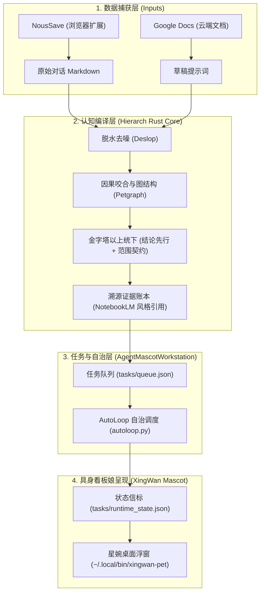

# 🐉 星婉全域系统进化回忆录【第 001 卷】

**归档日期**：2026-11-14  
**统御中枢**：星婉 (XingWan) · 四翅应龙制作人看板娘  
**系统版本**：v1.0.0-foundation  
**代码仓库**：[mkafw/AgentMascotWorkstation](https://github.com/mkafw/AgentMascotWorkstation)

---

## 零、 噪音滤除与正名清算（Tombstones）

> [!IMPORTANT]
> **绝对认知边界**：
> 1. **噪音抹除**：语音转录中的 `Anya` 确认为环境杂音/叹气的模型误判，系统中**不存在**该实体，不再对其进行任何检索。
> 2. **铲除大肥鱼**：彻底卸载清理此前测试混入的“大肥鱼/DeepSeek鲸鱼女仆”资产，所有贴图与台词均已在代码库和本地目录中永久剔除。
> 3. **唯一具身中枢**：系统的唯一看板娘兼总控制作人确立为 **【星婉】（上古四翅应龙龙女）**。

---

## 一、 星婉全域核心资产地图（Single Source of Truth）

所有星婉相关资产均已锁定并纳入版本管理：

| 资产类型 | 物理路径 | 详细说明 |
| :--- | :--- | :--- |
| **高精度透明立绘 (10组)** | [`/home/daoxuan/Downloads/xingwan/transparent/`](file:///home/daoxuan/Downloads/xingwan/transparent/) [`/home/daoxuan/Projects/AgentMascotWorkstation/assets/xingwan_transparent/`](file:///home/daoxuan/Projects/AgentMascotWorkstation/assets/xingwan_transparent/) | 经 Remove.bg 接口发丝级精修。包含：AI发丝精修 (`xingwan_kaleido_ai.png`)、Q版正面迎客 (`chibi_front.png`)、侧面露小龙尾 (`chibi_side.png`)、背面系带 (`chibi_back.png`)、应龙神女姿态等。 |
| **工作站总控中枢** | [`/home/daoxuan/Projects/AgentMascotWorkstation/`](file:///home/daoxuan/Projects/AgentMascotWorkstation/) | 融合四大项目（Live2D看版、AutoLoop闭环、LoopX控制台、Jev引擎）的核心中枢。 |
| **桌面浮窗界面** | [`pet_window.html`](file:///home/daoxuan/Projects/AgentMascotWorkstation/pet_window.html) | 纯透明无边框 Web 浮窗，支持点击互动、换装切换、抽屉式任务看板。 |
| **桌面启动脚本** | [`~/.local/bin/xingwan-pet`](file:///home/daoxuan/.local/bin/xingwan-pet) | 本地 Wayland / Hyprland 置顶启动器。 |
| **角色设定与提示词** | [`specs/XINGWAN_SHORT_DRAMA_PROMPTS.md`](file:///home/daoxuan/Projects/AgentMascotWorkstation/specs/XINGWAN_SHORT_DRAMA_PROMPTS.md) | 包含短剧文武戏分镜、自心写作心法、九大工种工业流水线提示词。 |
| **云端提示词容器** | Google Docs: `星婉角色设定提示词` | 关联 Google Apps Script 自动化优化。 |

---

## 二、 全网外脑搜索引擎与感知矩阵（MCP Search Matrix）

星婉工作站的外挂感知层已正式接通并持久化注册以下三大搜索引擎 MCP：

| 引擎代号 | 协议/服务名称 | 认证/密钥状态 | 核心能力与场景 | 挂载状态 |
| :--- | :--- | :--- | :--- | :--- |
| **Exa (AI 神经语义搜索)** | `exa-mcp-server` | `5be062d6-0e93-44ee-8437-e1e3eb6fda95` | `web_search_exa`、`web_fetch_exa`、`agent_run`。 专攻长尾知识语义匹配、深度页面脱水清洗，专为 LLM 设计。 | ✅ AGY 全局已激活 ✅ OpenCode 已写入 |
| **GR (Google Research / 深度研究)** | `gemini-notebook-mcp` + `gemini-chat` | 本地认证已打通 | `research_start`、`research_status`、`research_import`。 专攻超长研报合成、谷歌多模态学术级深度调研与推演。 | ✅ AGY 全局已激活 ✅ CLI 原生可用 |
| **DuckDuckGo (轻量即时检索)** | `duckduckgo-mcp-server` | 开源零密钥 | `duckduckgo_web_search`。 零配置、高并发、无封锁风险的即时事实与网页核实。 | ✅ AGY 全局已激活 ✅ OpenCode 已写入 |

---

## 三、 历史记录与对话数据资产存证

> [!NOTE]
> 前期的所有对话历史**完好无损**，已全部安全沉淀于以下两处，未受任何清理影响：
> 1. **浏览器 NousSave 实时镜像**：[`/home/daoxuan/GoogleDrive/NousSave/`](file:///home/daoxuan/GoogleDrive/NousSave/)
>    - `deepseek/`：长篇网文心法、推演大纲
>    - `gemini/`：高维总纲、分镜设定提示词
>    - `doubao/`：短剧文武戏拆解、角色建模规格
> 2. **AGY 认知轨迹池**：`~/.gemini/antigravity-cli/brain/` 完整保留每次探索记录。

---

## 四、 工程技术债复盘：为何割裂？如何彻底咬合？

### 1. 割裂成因复盘
- **单兵突进导致的信息孤岛**：
  前几天分别攻克了前端桌宠交互、后台 AutoLoop 自治调度、Google Docs 云端文本优化、Rust `hierarch` 认知编译器与 NousSave 采集。
- **割裂表现**：
  工具散落各处，缺少统一的数据流水线和控制平面，导致用户体验割裂。

### 2. 统一咬合架构（全域统御中枢）

---

## 五、 后续演进路线（Roadmap）

1. [x] **根除大肥鱼混淆**：代码库与本地文件彻底纯净化（完成于 2026-11-14）。
2. [x] **沉淀 Rust hierarch 编译器**：安装至 `/home/daoxuan/.local/bin/hierarch`（完成）。
3. [x] **建立第 001 卷回忆录**：在 Google Drive 和工作站建立回忆录体系（完成）。
4. [ ] **看板娘开机自启与状态常驻**：将 `xingwan-pet` 与 `autoloop.py` 绑定为用户级 systemd 服务。
5. [ ] **夜间回忆录自动化**：配置每日夜间自动执行清洗、蒸馏并生成每日《进化日记》。
