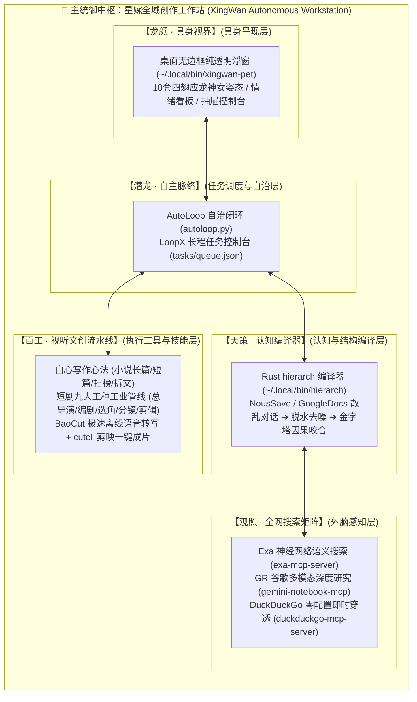

# 🐉 星婉全域系统进化回忆录【第 001 卷 · 大统领总纲】

**归档日期**：2026-11-14  
**统御中枢**：星婉 (XingWan) · 四翅应龙制作人看板娘  
**系统版本**：v1.0.0-unified  
**代码仓库**：[mkafw/AgentMascotWorkstation](https://github.com/mkafw/AgentMascotWorkstation)

---

## 零、 认知清理与正名清算（Tombstones）

> [!IMPORTANT]
> 1. **噪音彻底剔除**：转录语音中的 `Anya` 确认为环境杂音的模型误识，系统中不存在该实体。
> 2. **铲除大肥鱼**：彻底卸载清理 11-13 测试期临时借用的“大肥鱼（DeepSeek鲸鱼女仆）”贴图与台词。
> 3. **唯一且永久具身中枢**：**【星婉】（上古四翅应龙龙女）**，拥有发丝级去背立绘 10 组、紫蓝系麻花辫、女仆装蝴蝶结与神女姿态。

---

## 一、 历史大排查：过去四天我们到底构建了什么？

通过对 11 月 10 日至 11 月 14 日全部 AGY 对话轨迹的深度回溯，全系统演进脉络清晰如下：

| 日期区间 | 攻克的模块与心血 | 核心产物与落盘位置 | 为什么当时感到乱？ |
| :--- | :--- | :--- | :--- |
| **11-10** 素材与图谱探索 | 解决素材来源与吸收章法：接入 StarHub、卡帕西 `graphify-rs` 知识图谱、`gitnexus` 代码流。 | `mkafw/StarHub` `omni-search` (`gx`) 命令行 | 各种 CLI 命令散落，担心上下文太长。 |
| **11-11 ~ 11-12** 视听文创流水线 | 引入短剧 9 大工种、自心写作心法（五感八触/白描赋比兴）、`baocut` 离线语音与 `cutcli` 剪辑。 | 37 个专用 Skills Google Docs 提示词 | 技能库急剧膨胀，没有统一调度入口。 |
| **11-13** 四大项目融合 & 星婉诞生 | 提出将 4 大项目（Live2D看版、AutoLoop自治、LoopX控制台、Jev引擎）合体；配置 Exa、DuckDuckGo、Remove.bg。 | `mkafw/AgentMascotWorkstation` 10 组透明星婉切图 | 助手误借大肥鱼贴图测试，导致认知混淆。 |
| **11-14 (今日)** 因果编译 & 大一统 | 彻底清除大肥鱼；融合 5 大顶会项目手写 Rust `hierarch` 因果编译器；建立回忆录机制。 | `/home/daoxuan/.local/bin/hierarch` `GoogleDrive/Memoir/` | 模块各自为政，缺乏全局分层总纲。 |

---

## 二、 混乱根源深度诊断：为什么会觉得“太乱了”？

1. **“工具层”、“技能层”、“认知层”、“具身层”边界未划清**：
   - 把云端 Google Apps Script（文档格式化）误当成本地看板娘启动器；
   - 把 MCP 搜索引擎（工具）和 Skill 创作流（方法论）混在一块。
2. **缺乏一张清晰的“全局大一统中枢图”（Mental Map）**：
   - 4 天内高强度接入了 37 个技能、6 大 MCP、5 款独立二进制 CLI，但没有总谱表。
3. **“昨天的债今天又背”**：
   - 没有定期的“海马体睡眠整理机制”，废弃的试错（大肥鱼）没有及时打墓碑，造成心智重负。

---

## 三、 主系统与子系统：大一统分层与命名体系

全域以 **【星婉 · 全域智能工作站】** 为主统御中枢，下辖五大诗意子系统：

### 各层具体命名与职责规范：

| 层级编号 | 诗意子系统命名 | 核心组件与物理实体 | 解决什么问题 |
| :--- | :--- | :--- | :--- |
| **主系统** | **【星婉工作站】** | [`/home/daoxuan/Projects/AgentMascotWorkstation/`](file:///home/daoxuan/Projects/AgentMascotWorkstation/) | 全域唯一司令部与单一真实源头（SSOT） |
| **子系统 1** | **【龙颜 · 具身视界】** | [`~/.local/bin/xingwan-pet`](file:///home/daoxuan/.local/bin/xingwan-pet) | 屏幕右上角 100% 纯透明四翅应龙具身桌宠，任务与情绪投影 |
| **子系统 2** | **【潜龙 · 自主脉络】** | [`autoloop.py`](file:///home/daoxuan/Projects/AgentMascotWorkstation/autoloop.py) + `tasks/queue.json` | 遇卡点发卡片请人类拍板，其余时间后台静默闭环推进 |
| **子系统 3** | **【天策 · 认知编译器】** | [`/home/daoxuan/.local/bin/hierarch`](file:///home/daoxuan/.local/bin/hierarch) | 终结对话混乱：结论先行、以上统下、因果图谱与精准行号溯源 |
| **子系统 4** | **【观照 · 全网感知】** | **Exa** + **Gemini Deep Research** + **DuckDuckGo** | 提供实时外部证据、长尾网页全文深度脱水抓取 |
| **子系统 5** | **【百工 · 视听流水线】** | 37 个内置 Skills + `baocut` + `cutcli` | 短剧 9 大工种协同、长篇网文日更、秒级语音打轴与成片 |

---

## 四、 工具层（Tools / MCP）与技能层（Skills）透视清单

### 1. 工具层（已激活且稳定可用）
- **Exa MCP**：API Key 已持久化绑定，提供 AI 语义搜索与全文抓取。
- **Gemini Notebook MCP (GR)**：提供学术级 Deep Research 深度研究与报告生成。
- **DuckDuckGo MCP**：零配置即时轻量检索。
- **GitHub MCP**：代码、仓库、Issue 深度读写。
- **Z-Library MCP**：全网图书检索与自动化抓取。
- **本地二进制工具**：`hierarch` (Rust因果编译器)、`baocut` (SenseVoice离线语音识别)、`cutcli` (剪映工程自动化)、`omni-search` (全域搜索 `gx`)、`rga` (富文本搜索)。

### 2. 技能层（统一通过星婉调度）
- **写作类**：`自心写作总控`、`story-long-write`、`story-short-write`、`story-deslop` (去AI味)。
- **短剧类**：`ai-drama-pipeline` (9大工种)、`short-drama-storyboard` (分镜)、`seedance-storyboard-generator`。
- **剪辑类**：`baocut` (去口癖/打轴)、`cut-draft` (剪映草稿生成)。
- **整理与交接类**：`neat-freak` (洁癖知识库对齐)、`project-handoff` (长任务交接)。

---

## 五、 回忆录闭环机制：彻底斩断历史负债

1. **每日收尾一句话**：“**写今天回忆录**” 或 “**同步一下**” ➔ 自动触发 `neat-freak` 审查，将当天决定与产物编译进 `GoogleDrive/Memoir/`。
2. **新对话第一句话**：“**读星婉回忆录**” ➔ AI 瞬间加载全部系统契约，永不重犯历史错误！
